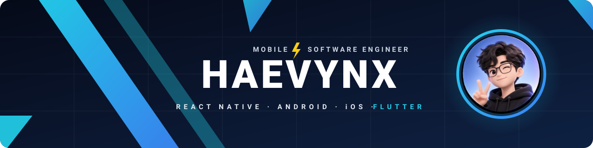

<p align="center">
  
</p>

<h3 align="center">Hi there, I'm <a href="https://github.com/haevynx">Haevynx</a> 👋</h3>

<h2 align="center">Software Engineer 💻 · Mobile 📱 · AI tooling 🤖</h2>

---

I build production mobile apps across **React Native, native Android & iOS, and Flutter** — and the web and backend pieces that power them. I care about the details that make apps hold up in the field: offline-first flows, camera & media capture, push notifications, secure authentication and painless OTA updates.

Lately I've been building **developer tooling for AI coding agents** — helping Claude Code and Codex learn an existing codebase and rebuild it on a new stack without guessing, and turning raw app screens into store-ready screenshots.

### 🤝 Connect with me

<p>
  <a href="https://www.linkedin.com/in/nguy%E1%BB%85n-v%C5%A9-%C4%91%C4%83ng-h%E1%BA%A3i-2045b9290" title="LinkedIn"></a>&nbsp;&nbsp;
  <a href="mailto:haevynx.dev@gmail.com" title="haevynx.dev@gmail.com"></a>
</p>

- 💬 Have a question, an idea or an opportunity? Don't hesitate to reach out — **haevynx.dev@gmail.com**

### 🔭 I'm currently working on

- **[shotforge](https://github.com/haevynx/shotforge)** — CLI that turns real app screens into polished, store-ready App Store & Google Play screenshots
  - 17 themes and 10 layouts distilled from top store listings · pixel-exact exports for both stores · every locale typeset correctly, diacritics included
  - AI copywriting, translation and artwork with Claude, OpenAI, Gemini or Grok · built to be driven by Claude Code and Codex

<p>
  <a href="https://github.com/haevynx/shotforge"></a>
</p>

- **[aegis](https://github.com/haevynx/aegis)** — Agent Skills + CLI that learn an insurance backend and its business features from a reference app, then integrate them into any stack and any state manager
  - *Learn → Ask → Do*: the agent reads the old source, stops for human approval, then builds and verifies
  - Guides for 7 platforms and 9 state managers · signatures verified **byte-for-byte** against the original app · zero dependencies · CI on Linux / macOS / Windows
- Exploring how AI coding agents can work safely on production code: verifiable output, human approval gates, no leaked secrets

```bash
curl -fsSL https://raw.githubusercontent.com/haevynx/aegis/main/install.sh | sh
```

### 🌱 I'm currently learning

- 🐍 **Python** for backend development — building APIs and services
- 🟣 **.NET** — C# and ASP.NET Core for backend services

<p>
  
</p>

### 🛠 Tech stack

<p>
  
  <br>
  
</p>
